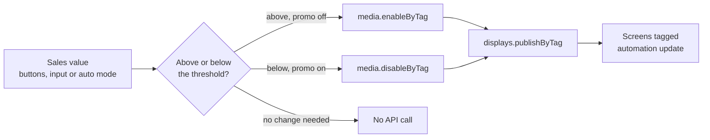

# Sales-driven promotions for digital signage

Use live business data to decide what plays on your screens. In this demo, a sales figure
controls a promotion: **when sales are above a threshold the promo plays, and when they fall below
it the promo is taken off every screen.** No one has to open the CMS.

It is a small local Node.js app built on the [EasySignage](https://www.easysignage.com) Open API
and the official [`@easysignage/sdk`](https://www.npmjs.com/package/@easysignage/sdk). EasySignage
is the backend here: it stores the content and runs the screens, while your own code decides what
plays.

> **Blog post:** [Automated Digital Signage for Retail: Run Promotions from Live Sales Data](https://easysignage.com/blog/26/sales-driven-promotions-digital-signage/) explains the use case, who it is for and how to roll it out.

## What it does

| Sales value | What the app does | API calls |
| --- | --- | --- |
| Above the threshold (default 100) | Turns the promo **on** | `media.enableByTag("promo")`, then `displays.publishByTag("automation")` |
| Below the threshold | Turns the promo **off** | `media.disableByTag("promo")`, then `displays.publishByTag("automation")` |
| Exactly at the threshold, or the promo is already in the right state | Nothing | none |

The demo UI has **Sales drop** / **Sales pick up** buttons, a box to type an exact number, and an
**Auto** mode that moves sales up and down by itself. An API log shows each SDK call, the HTTP
route behind it and the response, so you can see exactly what happens.

## How it works



Two tags connect everything:

- **`promo`** is on the media items that make up the promotion. Enabling or disabling by tag
  switches all of them in one call, however many there are.
- **`automation`** is on the screens that should follow the rule. Publishing by tag sends the
  change to all of them in one call.

The core of the app, from [`src/promo.ts`](src/promo.ts), is two calls:

```ts
import { EasySignage } from "@easysignage/sdk";

const client = new EasySignage(); // reads EASYSIGNAGE_API_KEY from the environment

async function setPromo(on: boolean) {
  if (on) await client.media.enableByTag("promo");
  else await client.media.disableByTag("promo");
  await client.displays.publishByTag("automation"); // nothing changes on screen until you publish
}
```

The rest of the app handles the details that matter in real use:

- **It only calls the API when the state actually changes.** Going from 150 to 160 makes no calls.
- **Calls run one at a time.** Clicking quickly can never send an enable and a disable out of order.
- **It reports problems clearly**, such as when no media carries the promo tag or no screen carries
  the screen tag (see [Troubleshooting](#troubleshooting)).

## Requirements

- **Node.js 20.12 or newer** (`node -v` to check)
- **An EasySignage account on a Premium or Enterprise plan.** API keys and tag-based publishing are
  part of those plans.
- **An API key** with permissions for **media**, **playlists** and **displays**
- **At least one screen** registered in your account. A browser player works fine for testing.

## Setup

### 1. Get the code and install

```bash
git clone https://github.com/easysignage/Digital-Signage-Sales-driven-promotions.git
cd Digital-Signage-Sales-driven-promotions
npm install
```

### 2. Create an API key

In the CMS at [app.easysignage.com](https://app.easysignage.com/), go to **Settings → API Keys**
and create a key with the **media**, **playlists** and **displays** permissions. The key is shown
only once, so copy it straight away.

### 3. Add the key to `.env`

```bash
cp .env.example .env
```

Open `.env` and set the key:

```
EASYSIGNAGE_API_KEY=ds_api_your_key_here
```

`.env` is listed in `.gitignore`, so it is never committed. Keep the key out of source code,
screenshots and issue reports. See [Keeping your API key safe](#keeping-your-api-key-safe).

### 4. Tag your screens

In the CMS, add the tag **`automation`** to each screen that should follow the rule. To use a
different tag, change `SCREEN_TAG` in `.env`.

### 5. Seed the demo content

```bash
npm run setup
```

This is safe to run more than once. It:

1. finds or creates a playlist called **"Sales demo"**,
2. uploads the images in [`samples/`](samples): the two `promo-*` images are tagged `promo`, and
   `regular-welcome.png` stays on screen when the promo is off,
3. assigns the playlist to every screen tagged `automation` and publishes them.

Using your own content instead? Add the `promo` tag to your promotional media items in the CMS,
make sure your screens play a playlist that contains them, and skip this step.

### 6. Run

```bash
npm run reset   # start with the promo off
npm run dev
```

Open **http://localhost:3000**.

## Using the demo

| Control | What it does |
| --- | --- |
| **▲ Sales pick up** | Sets sales to 140% of the threshold, which turns the promo on |
| **▼ Sales drop** | Sets sales to 60% of the threshold, which turns the promo off |
| **Set sales** | Applies the exact number you type |
| **Auto** | Moves sales up and down every 4 seconds, crossing the threshold in both directions |
| **Reset** | Turns the promo off, publishes and puts sales back at the threshold |

The badge shows whether the promo is on. The API log on the right shows each call as it happens.
After a publish, players fetch the update within a few seconds; the exact delay depends on the
player and its connection.

## Configuration

All settings live in `.env`. See [`.env.example`](.env.example).

| Variable | Default | Description |
| --- | --- | --- |
| `EASYSIGNAGE_API_KEY` | *(required)* | Your API key |
| `EASYSIGNAGE_BASE_URL` | `https://api.easysignage.io` | Only for white-label accounts that use their own API host |
| `PROMO_TAG` | `promo` | Media with this tag is switched on and off |
| `SCREEN_TAG` | `automation` | Screens with this tag are published after each change |
| `THRESHOLD` | `100` | Sales above this value turn the promo on; below it turn the promo off |
| `PORT` | `3000` | Port for the local web UI |

Tags are stored in lower case by EasySignage, so the app lower-cases them for you.

## Scripts

| Command | What it does |
| --- | --- |
| `npm run dev` | Starts the app and restarts it when the code changes |
| `npm start` | Starts the app |
| `npm run setup` | Creates the demo playlist, uploads the samples and assigns the playlist to your tagged screens |
| `npm run reset` | Turns the promo off and publishes, without starting the UI |
| `npm test` | Runs the unit tests for the on/off rule |
| `npm run typecheck` | Type-checks the project |

## Project structure

```
src/
  server.ts       Express server: UI, local API and live event stream
  promo.ts        Applies the rule: queue, enable/disable, publish, error reporting
  rule.ts         The on/off decision on its own, so it can be unit-tested
  simulator.ts    Auto mode
  easysignage.ts  SDK client, plus a wrapper that logs every call and its HTTP routes
  config.ts       Reads and validates .env
  log.ts          Event bus behind the live log (Server-Sent Events)
public/index.html The UI (plain HTML and JavaScript, no build step)
scripts/          setup and reset
samples/          Demo images used by `npm run setup`
test/             Unit tests
```

## Connecting real data

The simulator stands in for a real data source. To drive the promo from your own system, call
`setSales()` from [`src/promo.ts`](src/promo.ts) with the real number. For example, from a POS or
e-commerce webhook:

```ts
app.post("/webhooks/sales", async (req, res) => {
  await setSales(Number(req.body.totalLastHour));
  res.sendStatus(204);
});
```

You can also poll a reporting API on a timer. The rule already makes calls only when the promo
needs to change, so a frequent poll will not flood the API.

The same pattern works for any signal: weather, stock levels, footfall counters, queue length, or
the time of day. Choose a tag for the content, a tag for the screens, and a rule.

## Troubleshooting

| What you see | Cause and fix |
| --- | --- |
| `No media is tagged "promo"` | Nothing in the account carries the promo tag. Run `npm run setup`, or add the tag to your media in the CMS. |
| `No screens are tagged "automation"` (`publish_no_players`) | No registered screen carries the screen tag. Add the tag to a screen in the CMS. |
| `Publishing by tag is not included in this account's plan` (`feature_not_enabled`) | Tag-based publishing needs a Premium or Enterprise plan. |
| `403` on every call | The key is wrong or revoked, lacks a permission, or the plan has no API access. Check the key's permissions under **Settings → API Keys**. |
| The promo is enabled but doesn't appear | The screen isn't playing a playlist that contains the promo media. Run `npm run setup`, or add the media to the playlist your screens play. |
| `EASYSIGNAGE_API_KEY is not set` | `.env` is missing or the key is empty. See [Setup step 3](#3-add-the-key-to-env). |

## Keeping your API key safe

- The key gives full access to your account's data and **does not expire**. Treat it like a password.
- Keep it in `.env` only. `.env` is ignored by git, and `.env.example` contains no real values.
- The key is used only by the local Node.js server. The browser UI never sees it, and the server
  listens on `127.0.0.1` only. The SDK also refuses to run in a browser.
- Give the key only the permissions this demo needs (media, playlists, displays).
- If a key leaks, delete it under **Settings → API Keys** and create a new one.

## Links

- Blog post: [Automated Digital Signage for Retail: Run Promotions from Live Sales Data](https://easysignage.com/blog/26/sales-driven-promotions-digital-signage/)
- EasySignage Open API reference: open it from the CMS under **Settings → API Keys**, or go to
  [api-docs.easysignage.io](https://api-docs.easysignage.io/)
- SDK: [`@easysignage/sdk` on npm](https://www.npmjs.com/package/@easysignage/sdk)
- Companion demo: [Digital-Signage-Folder-Sync](https://github.com/easysignage/Digital-Signage-Folder-Sync),
  which keeps a playlist in sync with a local folder

## License

[MIT](LICENSE)
